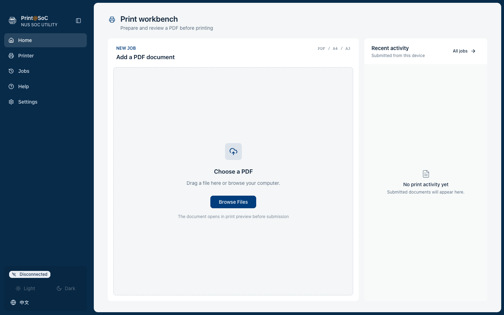

# Print@SoC

> This project began as an experimental solution to simplify printing for NUS School of Computing students. It has evolved into **Print@SoC**, a secure, zero-configuration cross-platform and easy-to-use printing tool designed for NUS students and staff.

---

## Interface



The interface uses a responsive workbench layout: document submission and recent
activity share the available desktop workspace, while mobile views stack tasks in
their natural order. Connection details remain in Settings and print options are
confirmed in Preview, keeping Home focused on the next print job.

---

## Problem Statement

### The Challenge with Official SoC Printing Configuration

While NUS School of Computing provides comprehensive printing infrastructure with printers across COM1, COM2, COM3, and other buildings, the official setup process presents significant challenges:

#### Traditional Setup Process (Official Documentation)

For macOS users, the official configuration requires:

1. Open System Settings → Printers & Scanners
2. Click "Add Printer"
3. Select IP Printer
4. Enter printer address: `print.comp.nus.edu.sg`
5. Select protocol: IPP (Internet Printing Protocol)
6. Enter queue name (e.g., `psts-dx`)
7. Download and install printer drivers (PPD files)
8. Configure paper size and choose Single-sided, Flip on long edge, or Flip on short edge. Long edge suits portrait book-style reading; short edge suits landscape book-style reading. Changing orientation preserves the selected binding edge.
9. ...15+ additional steps

#### Critical Issues

- Documentation written in 2015 for macOS 10.10, incompatible with modern macOS Ventura/Sonoma
- Outdated drivers that fail on newer operating systems
- Complex 15+ step configuration process prone to errors
- Each printer requires separate configuration
- Difficult troubleshooting when setup fails
- Platform-specific instructions (different for Windows, macOS, Linux)

#### Real Student Experience

> "I just wanted to print my assignment, but spent 2 hours configuring the printer and still failed."

**Setup Time:** 1-3 hours
**Success Rate:** ~60%

---

## Solution: Print@SoC

### Core Innovation

Instead of configuring local printer drivers, Print@SoC leverages SSH + `lpr` to bypass configuration complexity entirely.

#### Architecture Comparison

**Traditional Approach:**
```
macOS → Printer Driver → IPP Protocol → SoC Print Server → Printer
        ❌ Complex      ❌ Outdated    ❌ Poor compatibility
```

**Print@SoC Approach:**
```
Any Device → Print@SoC App/CLI → SSH → stu/stf Server → lpr → Printer
            ✅ Zero config      ✅ Automatic   ✅ Cross-platform
```

#### Key Insight

SoC students already have SSH credentials for accessing university servers and submitting assignments. Why not use the same SSH access for printing, eliminating local driver configuration entirely?

### User Experience

**With Print@SoC:**

1. Open Print@SoC
2. Log in with SoC credentials
3. Upload PDF file
4. Select printer queue
5. Click Print

**Setup Time:** 2 minutes
**Success Rate:** 95%+

---

## How It Works

### Technical Architecture

```
┌─────────────────────────────────────────┐
│      SoC Print Server                   │
│   (print.comp.nus.edu.sg)               │
│                                         │
│  ┌─────────────────────────────────┐   │
│  │  CUPS (Print Queue Manager)     │   │
│  │  - psc008-dx / psc008-sx        │   │
│  │  - psc011-dx / psc011-sx        │   │
│  │  - psts-dx  / psts-sx           │   │
│  └─────────────────────────────────┘   │
│           ▲                             │
│           │ Accepts lpr commands        │
└───────────┼─────────────────────────────┘
            │
    ┌───────┴───────┐
    │               │
    │ Method 1      │ Method 2
    │ IPP Protocol  │ SSH + lpr
    │ (Config req.) │ (Zero config)
    │               │
┌───▼──┐      ┌────▼─────┐
│Local │      │stu/stf   │
│Print │      │Server    │
│Setup │      │(SSH)     │
└──────┘      └──────────┘
```

### Behind the Scenes

When you upload `assignment.pdf`:

```bash
# 1. Upload file to server
scp assignment.pdf stu.comp.nus.edu.sg:~/temp/

# 2. Submit print job via lpr
ssh stu.comp.nus.edu.sg "lpr -P psts-dx -o sides=two-sided-long-edge ~/temp/assignment.pdf"

# 3. Check print queue status
ssh stu.comp.nus.edu.sg "lpq -P psts-dx"

# 4. Cleanup temporary file
ssh stu.comp.nus.edu.sg "rm ~/temp/assignment.pdf"
```

All of this happens automatically - users simply upload and print.

Binding is passed explicitly with the [CUPS `sides` option](https://www.cups.org/doc/man-lpr.html): `one-sided`, `two-sided-long-edge`, or `two-sided-short-edge`. The remote `lpr` and printer queue must support this option. The app does not silently retry with a different binding mode. The selected edge is also retained for n-up and booklet jobs; select short-edge binding for a landscape booklet.

Print@SoC defaults to `psts-dx`, one of the common public SOCprint queues in
COM1 Level 1. The student-facing default list follows SOCprint's common public
queues: `psc008-dx`, `psc008-sx`, `psc011-dx`, `psc011-sx`, `psts-dx`,
`psts-sx`, `pstb-dx`, `pstb-sx`, `pstc-dx`, and `pstc-sx`. After SSH
connection, the app also asks the selected SoC Unix server for `/etc/printcap`
and filters the visible queues against that live list.

### Why This Works

- ✅ `stu.comp.nus.edu.sg` and `stf.comp.nus.edu.sg` are within the campus network
- ✅ These servers have direct access to the print server
- ✅ Students already have SSH credentials
- ✅ The `lpr` command is available on these servers

---

## Key Advantages

| Dimension | Traditional Setup | Print@SoC |
|-----------|------------------|-----------|
| **Configuration** | 15+ manual steps | Zero configuration (credentials only) |
| **OS Compatibility** | Poor (outdated drivers) | Excellent (SSH-based) |
| **Cross-platform** | Different setup per OS | Identical across all platforms |
| **Maintenance** | High (reconfigure after OS updates) | Low (stable SSH) |
| **Troubleshooting** | Difficult (driver? network? config?) | Simple (clear SSH error messages) |
| **Learning Curve** | Steep (IPP/CUPS knowledge required) | Minimal (web interface) |

---

## Target Users

### Primary Audience

**Students (Undergraduate & Graduate)**
- Need to print assignments, lecture notes, and papers
- Familiar with SSH (Computer Science background)
- Want hassle-free printing without driver configuration

**Faculty & Staff**
- Use personal macOS/Windows computers
- Need to print course materials and exams
- Require quick and reliable printing

---

## Features

- **Zero Configuration:** No driver installation or printer setup required
- **Cross-Platform:** Works on macOS, Windows, Linux - any device with a browser
- **Secure:** Uses your existing SoC SSH credentials
- **Booklet Mode:** Automatic page arrangement for booklet printing
- **PDF Optimization:** Smart layout optimization for better print quality
- **Queue Management:** View and manage your print jobs
- **Multi-Printer Support:** Easy access to all SoC printer queues
- **CLI Aliases:** Launch with `print-at-soc`, `print-soc`, or `psoc`
- **MCP Server:** Start a local stdio MCP server with `print-soc mcp` or `psoc mcp`

---

## Technical Stack

- **Desktop Backend:** Tauri + Rust
- **SSH Integration:** `ssh2` for secure connections
- **PDF Processing:** Rust PDF tooling for layout optimization
- **Frontend:** React with modern UI components
- **Authentication:** SSH password is kept in memory for the active session; “remember account” stores only server and username

---

## Getting Started

### Prerequisites

- NUS SoC account credentials
- Access to NUS campus network (on-campus or VPN)

### Installation

Download the latest release for your platform from the [Releases](../../releases) page:

- **macOS Apple Silicon:** `Print_at_SoC_macos_aarch64.app.tar.gz`
- **macOS Intel:** `Print_at_SoC_macos_x86_64.app.tar.gz`
- **Windows:** `Print_at_SoC_windows_x86_64_setup.exe`
- **Linux:** `Print_at_SoC_linux_x86_64.AppImage`

Or install a CLI wrapper:

```bash
npm install -g print-at-soc
print-soc

pip install print-at-soc
psoc
```

### Updates and uninstall

```bash
print-soc self update --check
print-soc self update
print-soc self update --auto apply
print-soc self update --rollback
print-soc self uninstall --dry-run
print-soc self uninstall --purge --remove-cli
```

Updates verify downloads before replacing the desktop and retain a previous
version for rollback. Normal CLI desktop launches check daily (notification by
default); automatic installation is opt-in on macOS/Linux. The uninstall wizard
previews owned components and lets you retain data or purge app data and saved
credentials. Use `--plain` for simple text, or `--non-interactive --yes` in scripts.
Python/npm package upgrades and CUPS service refreshes remain separate from
desktop updates. See [maintenance and recovery details](docs/maintenance.md), including Windows
native-installer limits and the intentionally retained non-secret lock file.

### Virtual Printer

The Python CLI can install a macOS/Linux CUPS virtual printer queue. Apps print
to `Print@SoC Virtual Printer`, and the backend forwards the spool file through
SoC SSH to the configured remote `lpr` queue. The default remote queue is
`psts-dx`; pass `--printer` to choose another SOCprint queue.

```bash
pip install print-at-soc
print-soc --install-virtual-printer --username your-soc-id --ask-password --printer psts-dx
```

Start the interactive installer with:

```bash
print-soc virtual-printer install
```

The terminal wizard offers arrow-key menus for the server, authentication,
paper and sides; validates typed values; hides password input; and previews the
account and destination before asking to install. Decline the confirmation to
edit the settings or cancel before any system changes. Animated stage indicators run
only while work is happening, and stop before password prompts. Ctrl+C exits
cleanly. The result explains how to use the printer or shows stage-specific
repair steps when setup fails. Re-running setup repairs an existing queue.

```bash
# Walk through setup without passwords, sudo or system changes:
print-soc virtual-printer install --dry-run

# Simple numbered prompts, without colors or animation:
print-soc virtual-printer install --plain

# Scripted installation: authenticate the administrator separately first.
sudo -v
print-soc virtual-printer install --non-interactive --username YOUR_SOC_ID --key-path ~/.ssh/id_ed25519
```

Scripts can provide a password through `--password-stdin` (one line) or the
existing `PSOC_SSH_PASSWORD` environment variable. Avoid `--password` in shell
history. Non-interactive mode never prompts, including for sudo; missing inputs
produce an actionable error and nonzero exit code. Redirected output, `NO_COLOR`
and `TERM=dumb` produce plain logs. `--yes` skips only the final confirmation;
use `--non-interactive` to disable all prompts. Authentication sources are
mutually exclusive. Exit status is `0` for success/declined review, `1` for a
handled failure, `2` for invalid command arguments, and `130` for Ctrl+C/EOF.
A successful installation verifies the local queue, not remote SSH connectivity
or physical printing. Setup never automatically submits a test page.

In the desktop app, open **Settings → Advanced → Add system printer**.
Setup opens Terminal to request the SoC password and administrator authentication;
return to the app and refresh integration status after installation completes.
The same installer is available through the command above. Run it as your normal
user: it requests `sudo` only for system changes. A working CUPS service and a
system/Homebrew Python installed outside the home directory are required.

The installer snapshots the backend and its installed dependencies into a
root-owned system directory (`/Library/Application Support/PrintAtSoC/cups` on
macOS, `/usr/local/lib/print-at-soc/cups` on Linux). It stores the forwarding
configuration in `/etc/print-at-soc/virtual-printer.json` with mode `0600` and
copies an explicitly configured SSH key there with the same permissions. This
allows the CUPS service to run without access to a logged-in user's home or SSH
agent. All local Print@SoC queues use this system forwarding account. Re-run the
installer after upgrading the CLI to update the installed backend snapshot.
The normal user configuration remains available for CLI commands; configuring
an installed virtual printer also updates its system configuration.

Useful maintenance commands:

```bash
print-soc --configure-virtual-printer --server stu --username your-soc-id --ask-password --printer psts-dx
print-soc --virtual-printer-status
print-soc --uninstall-virtual-printer
```

Run `print-soc --uninstall-virtual-printer` before `pip uninstall print-at-soc`.
`pip uninstall` removes Python files only; it does not remove CUPS queues,
backend files, or Print@SoC configuration created outside pip metadata.

Windows virtual printer support is separate because Windows uses the modern
Print Support App/MSIX virtual printer architecture rather than CUPS backends.

### MCP Server

The desktop binary includes a stdio MCP server. Open **Settings → Advanced** to
run a handshake test and copy a client configuration that points to the exact
installed executable. The same page reports the CLI, CUPS queue, backend,
configuration file, and loaded Tauri plugins without assuming they are present.
After installing the Python CLI, the server is also available through either CLI alias:

```bash
print-soc mcp
psoc mcp
```

The MCP server exposes SSH connection, printer queue, quota, and PDF print submission tools. `submit_pdf_print_job` requires `confirm=true` because it sends a real print job.

An installable Codex plugin scaffold is included at `plugins/print-soc`. It
registers `print-soc mcp` and provides guarded printing instructions. Validate it
from the Codex plugin-creator skill before distribution; the target machine must
have the `print-soc` CLI on `PATH`.

### First-Time Setup

1. Launch Print@SoC
2. Select your preferred print server (`stu` or `stf`)
3. Enter your SoC username and password
4. Start printing

---

## Development

### Project Structure

```
Print-SoC/
├── app/                  # Tauri desktop application
│   ├── src/              # React frontend
│   ├── src-tauri/        # Rust backend and bundled MCP server
│   ├── public/           # Static assets
│   └── package.json      # Frontend scripts and dependencies
├── plugins/print-soc/    # Codex plugin and MCP registration
└── release/              # CLI packages and release assets
```

### Building from Source

```bash
# Clone repository
git clone https://github.com/Qingbolan/Print-SoC.git
cd Print-SoC

# Install dependencies
cd app
npm install

# Run the desktop app in development
npm run tauri:dev

# Run frontend and design checks
npm run check

# Build desktop packages
npm run tauri:build
```

---

## Roadmap

- [ ] Support for additional print options (color, stapling, etc.)
- [ ] Print history and cost tracking
- [ ] Batch printing support
- [ ] Mobile app version
- [ ] Integration with LumiNUS for direct assignment printing

---

## Contributing

Contributions are welcome! This project aims to improve the printing experience for the entire SoC community.

1. Fork the repository
2. Create a feature branch (`git checkout -b feature/improvement`)
3. Commit your changes (`git commit -am 'Add new feature'`)
4. Push to the branch (`git push origin feature/improvement`)
5. Open a Pull Request

---

## License

This project is licensed under the MIT License - see the [LICENSE](LICENSE) file for details.

---

## Acknowledgments

Built with the needs of NUS School of Computing students in mind. Special thanks to all early testers who provided valuable feedback.

**Print@SoC** - Because printing should be simple.

## Versioning and releases

All versions are generated by Tide. See [VERSIONING.md](VERSIONING.md) for local
builds, CI receipts, and the coordinated desktop/PyPI/npm release process.

### Remembering your login password

On the desktop login screen, select **Remember account and save password securely**.
After a successful SSH login, the password is stored in macOS Keychain, Windows
Credential Manager, or the Linux Secret Service. On later launches, press Connect
without re-entering it. Enter a new password to replace the saved one after a
successful login. Browser storage contains only the account identity and a saved
status flag; the backend reads saved passwords without returning them to the webview.

Clearing the saved account or logging out deletes its saved password. Unchecking
the option uses the typed password for this session without accessing the system
password store; existing saved credentials remain until explicitly cleared.
If the system password store is locked or unavailable, the app reports the error
and does not fall back to storing passwords in a file. Existing remembered accounts
need one successful password login to opt into secure password storage.

### Importing documents and images

The desktop workbench and preview accept PDF, static PNG/JPEG/WebP/BMP images,
and DOC/DOCX/ODT, PPT/PPTX/ODP, XLS/XLSX/ODS, RTF, TXT and CSV documents.
Images convert locally with transparency composited onto white paper and EXIF
orientation respected. Office/text formats require LibreOffice (detected in the
standard macOS/Windows installation or as `soffice` on PATH). Fonts and pagination
may differ from the originating application; review the converted PDF before printing.

Preview and printing use the same converted PDF. Conversions are reused by content
hash in the application's `imports` directory so saved drafts remain available.
Conversion inputs are limited to 128 MB and static images to 40 megapixels.
Animated images and unrecognized formats are rejected with an explanation. For
other applications or formats, use their native Print → Save as PDF. No claim is
made to render arbitrary binary files.

macOS controls Keychain authorization prompts. Selecting **Always Allow** grants
this app access to that item; rebuilding an unsigned development binary may cause
macOS to request authorization again. The app retains credentials only in memory
for active SSH reconnects and clears them on disconnect, reducing repeated reads.
New accounts do not save passwords unless the checkbox is selected.

### Layout and interrupted submissions

Page selection, n-up and booklet layout require `pdfjam` with TeX Live on the
local desktop. Booklet mode arranges pages for folding, adds blank pages when
needed, and starts with landscape/short-edge duplex settings. Review both sides
before printing. A missing layout tool stops the job before upload.

Imported PDFs are kept as immutable local copies, including when the source is
already a PDF. Moving or editing the original after import does not change the
previewed document. A document must finish preparation before it can be submitted.

After a restart, interrupted preparation can be retried. A job that may already
have reached the printer is checked against its original account and receipt;
it is never automatically printed again. If a queue ID cannot be recovered,
check the queue and the physical output before using the manual confirmation
controls in job details. Confirmation updates history only.
