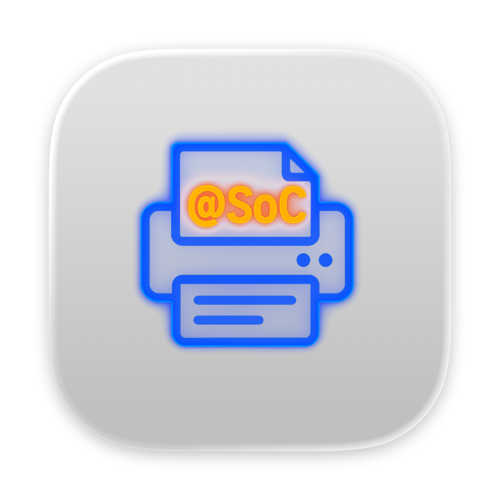
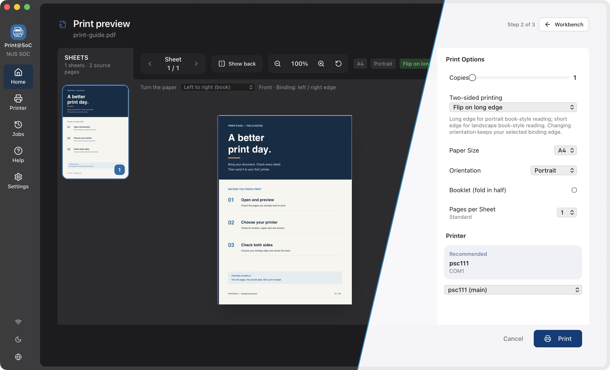
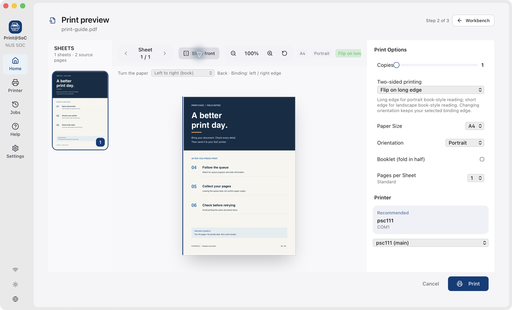
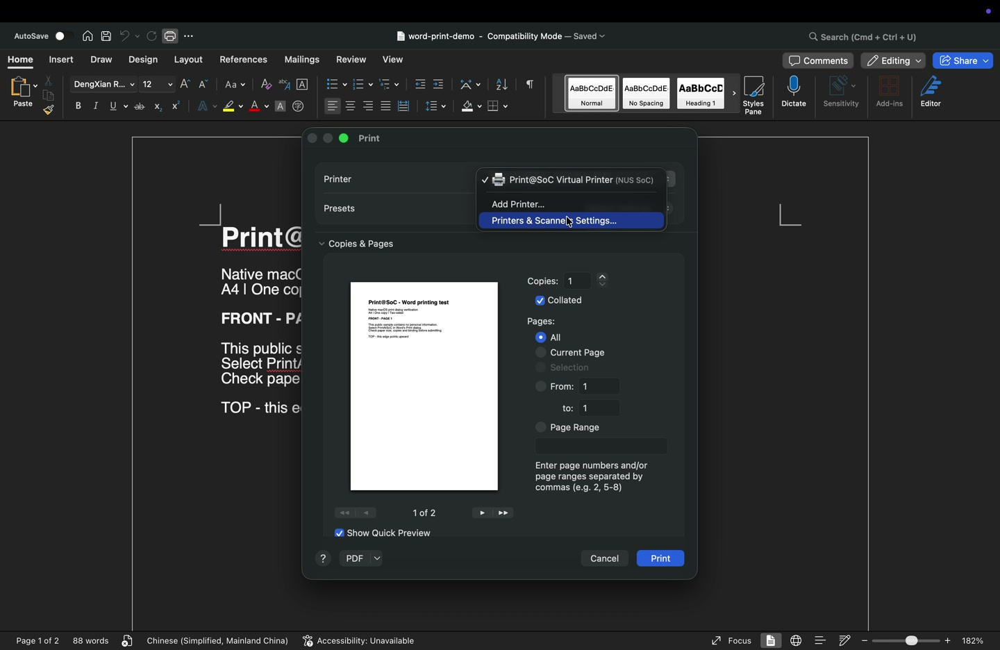

<p align="center">
  
</p>

<h1 align="center">Print@SoC</h1>

<p align="center"><strong>Print your assignment. Skip the per-printer setup.</strong></p>
<p align="center"><strong>Prefer printing from Word?</strong> On macOS and Linux, run <code>print-soc virtual-printer install</code><br />to add a Print@SoC printer through a guided setup. <a href="#one-command-system-printer-setup">Setup requirements →</a></p>

<p align="center">
  <a href="https://pypi.org/project/print-at-soc/"></a>
  <a href="release/python-pip/LICENSE"></a>
  <a href="#desktop"></a>
  <a href="#desktop"></a>
  <a href="#desktop"></a>
</p>

<p align="center">
  <a href="https://github.com/Qingbolan/Print-SoC/releases/latest">Download</a> ·
  <a href="#features">Features</a> ·
  <a href="#one-command-system-printer-setup">System printer setup</a> ·
  <a href="#watch-it-in-action">Demo</a> ·
  <a href="#first-print">First print</a> ·
  <a href="docs/usage.md">User guide</a> ·
  <a href="https://github.com/Qingbolan/Print-SoC/issues">Report an issue</a>
</p>



<p align="center"><sub>Dark / light comparison · two actual macOS captures joined diagonally · local development build.</sub></p>

**Preview before you print.** Review the page, choose your binding edge, and keep the printer settings in view. [Try the sample PDF](docs/examples/print-guide.pdf) or [inspect the screenshot provenance](app/screenshots/readme/CAPTURES.md).

<details>
<summary>See the reverse-side preview</summary>



The same two-page document, viewed from the back. This is a preview, not proof of physical duplex output.

</details>

## Why I built this

I started my master’s at NUS in 2025. One of the things I struggled with as a new student was getting the SoC printers to work from my Mac. Installing and configuring the drivers took more effort than I expected for something as ordinary as printing a document.

Printing over SSH gave me another way in, but I still ran into problems. When I printed my ICA Student’s Pass (STP) documents, the content came out so enlarged that parts of the pages were cut off. Files that weren’t PDFs meant extra conversion steps before I could submit them. And when I needed to check something I’d printed earlier, I had no convenient history to return to.

That’s why I started Print@SoC. I wanted to see the page before sending it, print the files I actually had, and find my previous jobs afterward. The school’s servers could already do the printing; I wanted the steps around it to be easier.

I’m now a PhD student, and I still see new students arriving at SoC and struggling with the same printer setup. I remember how frustrating that was when I first arrived. I hope sharing this project helps them spend less time figuring out how to print and get on with what they came here to do.

The app brings document preparation, preview, printer selection and history together. You can print from it without setting up each campus printer locally. If you prefer Word’s own Print dialog, the optional virtual printer gives you that route too, with one command to start its setup.

[Why I built this](#why-i-built-this) · [Problem statement](#problem-statement) · [Design rationale](#solution-printsoc) · [Install](#install) · [Architecture](#how-it-works) · [Development](#development)

## Features

- **One-command virtual printer setup:** run `print-soc virtual-printer install` to add Print@SoC to the macOS/Linux system printer list through an interactive Rust wizard. Print from your application's normal Print dialog.
- **Preview before submission:** import PDFs, images and Office documents, inspect the prepared pages, and review front/back layout with the print settings alongside.
- **Paper and layout controls:** choose copies, paper size, orientation, duplex binding, n-up or booklet layout. Conversion and advanced-layout dependencies are listed below.
- **One account across entry points:** desktop and native printing use the shared SoC account and operating-system credential store.
- **Job tracking and history:** inspect desktop and system-originated jobs, see the number of jobs ahead when queue evidence is available, and distinguish queue departure from confirmed paper output.
- **Guided maintenance:** interactive installation, update checks, download verification, recovery and an uninstall preview with data-retention choices.
- **CLI and MCP access:** launch and inspect the application from the terminal, or integrate the bundled stdio MCP server with a compatible client.
- **Light and dark themes:** use the same document workspace in either appearance, with English and Chinese interface options.

### One-command system printer setup

```sh
print-soc virtual-printer install
```

**On macOS/Linux, after installing the CLI and a desktop build with the Rust driver, save your SoC account in the desktop first.** This command opens a guided installer: choose the destination queue, paper and duplex defaults, review the proposed changes, and authenticate locally when administrator access is required. It registers the local CUPS printer, installs the Rust backend and configures the user-session service.

After setup, select **PrintAtSoC** in another application's Print dialog. The Rust service submits through your shared SoC account and retains the job PDF for GUI history and preview. Keep your login session, credential store and SoC network connection available while printing. The native print-processing path does not depend on Python.

```sh
# Inspect the plan without installing or printing:
print-soc virtual-printer install --dry-run

# Check the installed integration:
print-soc virtual-printer status
```

This is one command to start guided configuration, not a promise of unattended installation without credentials or administrator authorization. The CUPS installer does not provide a Windows system driver. [Full setup and removal guide](docs/usage.md#virtual-printer).

## Watch it in action

[](app/screenshots/readme/word-native-print.mp4)

**[Watch the real Word printing recording (MP4)](app/screenshots/readme/word-native-print.mp4)** · [Open the Word sample](docs/examples/word-print-demo.rtf)

Recorded on macOS with a public two-page sample: open Word's Print dialog, select **Print@SoC Virtual Printer**, review copies and page controls, then click Print. This is a continuous screen recording at original speed, trimmed to remove the recording toolbar at the end. It does not show driver installation or changing duplex binding. A separate live test verified A4 short-edge duplex output; see the [validation record](docs/repair-validation-2026-11-17.md).

## Problem Statement

### The challenge with local printer configuration

A student trying to print an assignment needs to make several independent choices: which printer is accessible, which queue reaches it, how to authenticate, and how to express paper and duplex settings. A conventional network-printer setup exposes these choices through operating-system-specific configuration screens and printer drivers.

The configuration work typically includes selecting a network endpoint and protocol, identifying a queue, choosing a driver or printer description, and setting defaults. These details matter, but they are separate from the user's immediate task: reviewing a document and getting the intended pages onto paper. The exact setup varies by operating system and queue; there is no single step count or measured failure rate claimed here.

Three concrete use cases motivated Print@SoC:

- **An assignment from a personal laptop:** the user wants to preview a PDF and choose a nearby accessible printer without creating a separate local printer entry for every destination.
- **Slides or documents from another application:** the user wants familiar Print-dialog controls, with the resulting PDF and effective settings visible in the same job history.
- **An apparently stalled submission:** the user needs to distinguish a failed upload, a queued job and a job that has left the server queue before deciding whether to retry.

The third case makes observability part of the printing problem. A successful submission command is useful evidence, but it does not establish that the document has physically printed. Retrying on that assumption can produce duplicate output.

## Solution: Print@SoC

### Core idea

SoC users already have an account for accessing university Unix services. Print@SoC uses that authenticated SSH connection to submit documents through the server's existing `lpr` interface and inspect its queues. The university infrastructure continues to own queue access and printer delivery; the application owns document preparation, submission tracking and the user interface.

### Architecture comparison

```text
Conventional network-printer setup
  Application → OS print system + printer configuration
              → campus print service → physical printer

Print@SoC document workflow
  Document → desktop preview + preparation
           → authenticated SSH → SoC Unix server → lpr → physical printer

Optional Print@SoC system-printer workflow
  Application → OS print dialog → local CUPS + Rust backend
              → Rust service → authenticated SSH → SoC lpr → physical printer
```

The direct document workflow avoids per-destination local driver setup. The optional system printer addresses a different need: printing from applications that already render their own documents. It adds a local integration point while retaining the shared submission and history model.

### Why this approach fits the use case

| Design choice | What it gives the user | Remaining constraint |
| --- | --- | --- |
| Reuse SoC SSH authentication | One account for the desktop and native print service | The account must be authorized and the server reachable. |
| Submit through the server's print commands | Select a remote queue without configuring each printer locally | Queue capabilities and access restrictions remain server-specific. |
| Prepare a PDF before submission | Inspect the document that will be sent | Office conversion and advanced layout need additional local tools. |
| Share a job lifecycle across entry points | Inspect system-originated and desktop jobs in one workspace | A queue observation cannot prove physical output. |
| Use a standalone Rust CUPS backend | System printing does not depend on the user's Python environment | CUPS integration applies to macOS/Linux and needs installation. |

The goal is to reduce the configuration required for a concrete print task while making the remaining dependencies and uncertain outcomes visible. It does not require replacing the university's printing infrastructure or claiming that every printer implements the same options.

## Install

You need a **SoC account** and network access to your SoC Unix server, through the campus network or NUS VPN as appropriate. This is an independent community project, not an official NUS service.

### Desktop

Choose the installer for your machine from [GitHub Releases](https://github.com/Qingbolan/Print-SoC/releases/latest).

| Platform | Download |
| --- | --- |
| macOS | Apple Silicon or Intel application archive |
| Windows | x86-64 setup executable |
| Linux | x86-64 AppImage |

The release page is the authority for available assets. This README describes the current source tree; changes under development may not yet be in the published desktop or package launchers.

### Command line

Choose **one** launcher. Both expose `print-soc`, `print-at-soc`, and `psoc`.

```sh
# Python launcher (Python 3.8+)
python3 -m pip install print-at-soc
print-soc --install
print-soc
```

```sh
# npm launcher (Node.js 14.14+)
npm install -g print-at-soc
print-soc --install
print-soc
```

The launchers install the desktop separately. npm’s maintenance wizard also requires Python 3.8+ with `venv`; the Rust system-printing path does not. See [installation, update and recovery details](docs/maintenance.md).

## First print

1. Open Print@SoC and select your SoC server, such as `stu` or `stf`.
2. Connect with your SoC account. Saving the password in the operating system’s credential store is optional.
3. Choose **Browse Files** or drop a document into the workspace.
4. Review the converted PDF, choose an accessible printer, and check paper size, copies and binding edge.
5. Submit once, then follow the job in **Jobs**. History is ordered newest first.

The printer catalogue is filtered against the connected server’s queues. A listed printer may still have room-access restrictions. Check the [printer catalogue sources](docs/printer-catalog-sources.md) before choosing an unfamiliar location.

## What you can do

| Task | Support and requirements |
| --- | --- |
| Preview and print PDF | Imported documents are retained as local copies; preview and submission use the same prepared PDF. |
| Print images | Static PNG, JPEG, WebP and BMP; transparency is composited onto white paper. |
| Print slides and Office files | PPT/PPTX/ODP, DOC/DOCX/ODT and XLS/XLSX/ODS, plus RTF/TXT/CSV, require local LibreOffice. Review conversion before printing. |
| Arrange pages | Page selection, n-up and booklet layout require `pdfjam` with TeX Live. |
| Print from another application | Optional macOS/Linux CUPS printer with a standalone Rust backend and user-session service. See [system printer setup](docs/usage.md#virtual-printer). |
| Track jobs | Queue association uses `lpq -l`, the account and the unique submitted filename; fresh, complete snapshots provide the number of jobs ahead. |
| Automate | CLI launchers and a bundled stdio MCP server; real print submission requires explicit confirmation. |

Long-edge and short-edge choices are retained in job settings. Physical binding depends on the remote queue and its `lpr` implementation. A live macOS test through Word, the installed Rust driver and `psc111` verified A4 short-edge duplex output, with the user confirming the physical result. The system job appeared in GUI history and preview, and queue tracking advanced from printing to left queue. This result is specific to that printer and environment. See the [live validation record](docs/repair-validation-2026-11-17.md). See the [interface investigation and live test record](docs/soc-print-interface-investigation-2026-11-17.md).

### What the job status means

- **Submitted / awaiting confirmation:** the submission was accepted, but its outcome is not yet established.
- **Queued / printing:** the job was matched in the remote queue. A reliable snapshot can show how many jobs are ahead; stale or unavailable information is identified explicitly.
- **Left queue:** the job is no longer in a successfully queried queue. This does **not** prove that paper physically emerged.
- **Output confirmed:** the user has confirmed the physical output.

A failed query does not mark a job completed. An interrupted submission that may already have reached the server is reconciled instead of automatically printed again.

## Updates and removal

```sh
print-soc self update --check
print-soc self update
print-soc self update --rollback
print-soc self uninstall --dry-run
print-soc self uninstall
```

The uninstall wizard previews owned components and offers data retention or cleanup. Updates verify downloads and retain a previous installation for recovery. macOS/Linux support opt-in installation on CLI launch; Windows uses its native installer and has different rollback limits.

CLI launch-time checks are not a background updater. Opening the desktop directly does not invoke that check. Python/npm package upgrades and installed CUPS service refreshes are separate operations. Read the [maintenance guide](docs/maintenance.md) for automatic-update settings, recovery and purge options.

## Accounts and privacy

The desktop and native printing service share one account identity. When enabled, saved passwords live in macOS Keychain, Windows Credential Manager or Linux Secret Service; they are not stored in the account JSON or returned to the webview. A locked credential store produces an error rather than a plaintext fallback.

Documents are converted locally, then transferred to the selected SoC server for printing. Imported PDFs and job history remain locally for preview and recovery. Review [account storage and document handling](docs/usage.md) before using a shared computer.

## How it works

```text
Desktop document → local PDF preparation ──────────────┐
                                                       ├→ Rust print service → SSH → SoC lpr → printer
Application Print → local CUPS → Rust backend → PDF ───┘
                                                                   ↑
                                                   queue tracking via lpq -l
```

The React interface and Rust backend are packaged with Tauri. The optional CUPS integration uses a standalone Rust executable and a login-session service; it does not require Python in the printing path. Windows system-driver integration is not provided by this CUPS installer.

### Behind the scenes

For a document such as `assignment.pdf`, the workflow has four responsibilities:

1. **Prepare:** retain a local copy, convert supported input formats to PDF, and apply requested layout transformations before submission. Native CUPS output may already contain page selection, orientation and n-up; those transformations must not be applied twice.
2. **Submit:** transfer the prepared document under a unique attempt filename and invoke the selected server queue through SSH. A receipt records submission progress so an interrupted operation can be reconciled without blindly resending it.
3. **Observe:** inspect `lpq -l`, associate the account and unique filename with a queue job, and retain its remote identifier. A complete, fresh queue snapshot can establish how many jobs precede it; a failed or partial query cannot.
4. **Reconcile:** update local history from the available evidence. Queue departure and user-confirmed paper output remain distinct outcomes.

For context, the remote command interface used in the documented SoC investigation is:

```sh
# On the SoC Unix server; submitting consumes a real print job.
# Replace both placeholders with an accessible queue and a prepared PDF.
lpr -P <queue> <prepared-document.pdf>

# Read the queue, including long-format job and filename information.
lpq -l -P <queue>
```

These commands explain the server boundary; the application also manages credentials, file transfer, local persistence and interrupted submissions. They are not a replacement installation script.

### Implementation boundaries

The desktop interface handles document selection, preview and settings. Rust owns SSH access, document preparation and the job lifecycle. The native CUPS backend accepts the OS-rendered document and passes it to a user-session service, which uses the shared account and persists system jobs for the GUI. Package launchers handle distribution and maintenance separately from the native printing path.

This separation serves a specific recovery requirement: closing the GUI must not make a system-originated job disappear from history, and a desktop restart must not turn an uncertain submission into an automatic duplicate print.

The remote SoC tools are not assumed to be CUPS-compatible simply because their commands share names. Protocol details, queue matching and observed limitations are recorded in the [printing interface investigation](docs/soc-print-interface-investigation-2026-11-17.md).

## Development

Install Node.js/npm, Rust and the [Tauri platform prerequisites](https://v2.tauri.app/start/prerequisites/). Read [VERSIONING.md](VERSIONING.md) and install the pinned Tide CLI before building: `scripts/version.py` owns every version projection.

```sh
git clone https://github.com/Qingbolan/Print-SoC.git
cd Print-SoC/app
npm ci
npm run tauri:dev
```

```sh
# From app/
npm run check
cargo test --manifest-path src-tauri/Cargo.toml --lib
npm run tauri:build
```

| Location | Responsibility |
| --- | --- |
| [app/src](app/src) | React workspace, preview, settings and job views |
| [app/src-tauri/src](app/src-tauri/src) | Rust document pipeline, SSH, job lifecycle and native integration |
| [release](release) | Python/npm launchers and distribution tooling |
| [plugins/print-soc](plugins/print-soc) | Codex plugin scaffold and MCP registration |
| [VERSIONING.md](VERSIONING.md) | Tide versions and shared release receipts |

## Help and contributing

Start with the [user guide](docs/usage.md) and [maintenance guide](docs/maintenance.md). For a bug, [open an issue](https://github.com/Qingbolan/Print-SoC/issues) with your OS, app version, reproduction steps and expected result. Remove passwords, tokens and private document content from logs or screenshots.

Contributions should include focused checks and explain any effect on real printing. Hardware claims should state the printer, submitted settings and observed paper output. See [AGENTS.md](AGENTS.md) for repository instructions.

Package license texts: [Python distribution](release/python-pip/LICENSE) · [npm distribution](release/node.js-npm/LICENSE).
